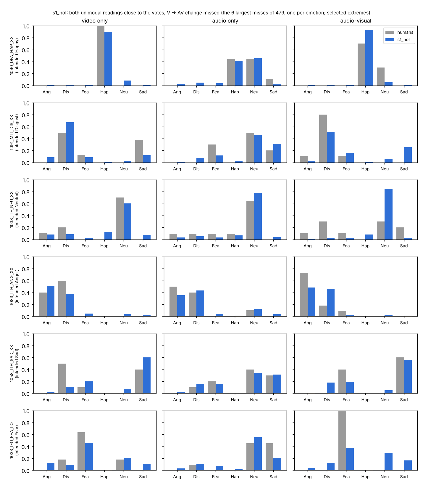

# Cross-condition diagnostic: does soft-label SFT reproduce how judgements change to AV?

Generated by `analysis/cross_condition_diagnostic.py`. 7438 clips, 91 actors, each read by the fold model that never saw its actor (Stage 1, seed 0). CIs: 95% bootstrap over actors (300). Human re-run = agreement of 20 simulated re-runs of the human study with the observed votes.

## 1_each_condition

| condition | predictor | JSD to votes (lower is better) | top label among raters' top | Spearman(H(q), H(p)) |
|---|---|---|---|---|
| V | m3 | 0.148 [0.143, 0.154] | 0.625 [0.605, 0.646] | 0.396 [0.363, 0.431] |
| V | s1_noI | 0.142 [0.138, 0.146] | 0.651 [0.633, 0.668] | 0.405 [0.371, 0.440] |
| V | human re-run (reference) | 0.096 | 0.784 | 0.549 |
| A | m3 | 0.116 [0.113, 0.118] | 0.656 [0.643, 0.671] | 0.349 [0.326, 0.374] |
| A | s1_noI | 0.087 [0.086, 0.089] | 0.774 [0.764, 0.787] | 0.501 [0.481, 0.519] |
| A | human re-run (reference) | 0.100 | 0.730 | 0.480 |
| AV | m3 | 0.090 [0.087, 0.093] | 0.797 [0.782, 0.810] | 0.554 [0.530, 0.573] |
| AV | s1_noI | 0.088 [0.085, 0.091] | 0.802 [0.787, 0.815] | 0.565 [0.541, 0.585] |
| AV | human re-run (reference) | 0.095 | 0.807 | 0.527 |

## 2_changes_to_AV

| change | predictor | clips | n | redistribution: cosine (||Dh|| >= 0.1) | redistribution: correlation over clip x label | redistribution: sign agreement where humans move >= 0.2 | magnitude: mean||Dm|| / mean||Dh|| | entropy change: Spearman(dH_m, dH_h) | entropy change: sign agreement where |dH_h| >= 0.15 |
|---|---|---|---|---|---|---|---|---|---|
| V -> AV | m3 | all clips | 7438 | 0.242 [0.223, 0.261] | 0.288 [0.265, 0.313] | 0.689 [0.678, 0.702] | 0.967 [0.935, 1.002] | 0.191 [0.167, 0.218] | 0.606 [0.590, 0.625] |
| V -> AV | m3 | both unimodal readings good | 1722 | 0.370 [0.338, 0.403] | 0.519 [0.483, 0.552] | 0.786 [0.761, 0.807] | 0.745 [0.717, 0.775] | 0.389 [0.337, 0.430] | 0.712 [0.683, 0.739] |
| V -> AV | s1_noI | all clips | 7438 | 0.258 [0.242, 0.276] | 0.326 [0.306, 0.345] | 0.712 [0.700, 0.724] | 0.943 [0.916, 0.977] | 0.202 [0.177, 0.228] | 0.605 [0.588, 0.623] |
| V -> AV | s1_noI | both unimodal readings good | 1800 | 0.366 [0.335, 0.393] | 0.522 [0.489, 0.551] | 0.787 [0.762, 0.810] | 0.795 [0.766, 0.826] | 0.416 [0.378, 0.455] | 0.732 [0.708, 0.762] |
| V -> AV | emotion prior (other folds) | all clips | 7438 | 0.222 [0.206, 0.237] | 0.255 [0.238, 0.271] | 0.682 [0.670, 0.697] | 0.292 [0.286, 0.300] | 0.143 [0.123, 0.173] | 0.600 [0.582, 0.618] |
| V -> AV | human re-run (reference) | all clips | 7438 | 0.462 | 0.550 | 0.792 | 1.491 | 0.391 | 0.688 |
| V -> AV | human re-run (reference) | both unimodal readings good (s1_noI subset) | 1800 | 0.447 | 0.529 | 0.787 | 1.561 | 0.376 | 0.687 |
| V -> AV | emotion prior (other folds) | both unimodal readings good (s1_noI subset) | 1800 | 0.298 [0.267, 0.323] | 0.339 [0.306, 0.369] | 0.752 [0.727, 0.776] | 0.273 [0.263, 0.283] | 0.289 [0.244, 0.338] | 0.730 [0.691, 0.761] |
| A -> AV | m3 | all clips | 7438 | 0.302 [0.281, 0.323] | 0.508 [0.483, 0.532] | 0.727 [0.713, 0.741] | 0.482 [0.466, 0.499] | 0.325 [0.300, 0.351] | 0.644 [0.630, 0.660] |
| A -> AV | m3 | both unimodal readings good | 1722 | 0.457 [0.426, 0.490] | 0.699 [0.679, 0.724] | 0.848 [0.829, 0.867] | 0.565 [0.542, 0.587] | 0.527 [0.493, 0.561] | 0.766 [0.739, 0.794] |
| A -> AV | s1_noI | all clips | 7438 | 0.472 [0.451, 0.491] | 0.684 [0.667, 0.698] | 0.824 [0.812, 0.833] | 0.664 [0.645, 0.683] | 0.434 [0.406, 0.460] | 0.734 [0.718, 0.749] |
| A -> AV | s1_noI | both unimodal readings good | 1800 | 0.570 [0.541, 0.599] | 0.807 [0.790, 0.820] | 0.884 [0.869, 0.897] | 0.752 [0.731, 0.777] | 0.588 [0.554, 0.617] | 0.813 [0.787, 0.837] |
| A -> AV | emotion prior (other folds) | all clips | 7438 | 0.483 [0.461, 0.505] | 0.653 [0.636, 0.669] | 0.821 [0.809, 0.833] | 0.630 [0.618, 0.643] | 0.300 [0.263, 0.331] | 0.727 [0.702, 0.745] |
| A -> AV | human re-run (reference) | all clips | 7438 | 0.573 | 0.693 | 0.834 | 1.166 | 0.457 | 0.722 |
| A -> AV | human re-run (reference) | both unimodal readings good (s1_noI subset) | 1800 | 0.562 | 0.681 | 0.835 | 1.184 | 0.454 | 0.734 |
| A -> AV | emotion prior (other folds) | both unimodal readings good (s1_noI subset) | 1800 | 0.518 [0.490, 0.551] | 0.727 [0.707, 0.745] | 0.847 [0.831, 0.864] | 0.693 [0.674, 0.714] | 0.433 [0.388, 0.471] | 0.807 [0.782, 0.832] |

## 3_integration

| predictor | clips with differing unimodal votes | mean audio weight w | Spearman(w, human w) | disambiguation rate (all clips) | recall of human disambiguation | precision |
|---|---|---|---|---|---|---|
| humans (observed) | 5613 | 0.347 |  | 0.300 |  |  |
| m3 | 5613 | 0.519 [0.504, 0.534] | 0.313 [0.285, 0.344] | 0.141 [0.128, 0.154] | 0.192 [0.172, 0.213] | 0.407 [0.376, 0.433] |
| s1_noI | 5613 | 0.491 [0.473, 0.512] | 0.380 [0.351, 0.409] | 0.388 [0.366, 0.410] | 0.479 [0.450, 0.505] | 0.370 [0.352, 0.390] |
| human re-run (reference) | 5613 | 0.407 | 0.446 | 0.306 | 0.476 | 0.466 |

## 4_failure_cases_s1_noI

| clip | intended | votes V/A/AV | human V | model V | human A | model A | human AV | model AV | cosine(Dm, Dh) V->AV |
|---|---|---|---|---|---|---|---|---|---|
| 1040_DFA_HAP_XX | Happy | 10/9/10 | Hap 1.00 | Hap 0.90 Neu 0.08 | Hap 0.44 Neu 0.44 Sad 0.11 | Hap 0.41 Neu 0.45 | Hap 0.70 Neu 0.30 | Hap 0.93 Neu 0.05 | -1.000 |
| 1091_MTI_DIS_XX | Disgust | 8/10/10 | Dis 0.50 Fea 0.12 Sad 0.38 | Ang 0.09 Dis 0.67 Fea 0.09 Sad 0.12 | Fea 0.30 Neu 0.50 Sad 0.20 | Dis 0.08 Fea 0.12 Neu 0.46 Sad 0.31 | Ang 0.10 Dis 0.80 Fea 0.10 | Dis 0.50 Fea 0.16 Neu 0.06 Sad 0.25 | -0.920 |
| 1038_TIE_NEU_XX | Neutral | 10/11/10 | Ang 0.10 Dis 0.20 Neu 0.70 | Ang 0.08 Dis 0.09 Hap 0.13 Neu 0.60 Sad 0.07 | Ang 0.09 Dis 0.09 Fea 0.09 Hap 0.09 Neu 0.64 | Dis 0.05 Hap 0.07 Neu 0.78 | Ang 0.10 Dis 0.30 Fea 0.10 Neu 0.30 Sad 0.20 | Hap 0.08 Neu 0.85 | -0.910 |
| 1083_ITH_ANG_XX | Anger | 10/10/11 | Ang 0.40 Dis 0.60 | Ang 0.51 Dis 0.38 | Ang 0.50 Dis 0.40 Neu 0.10 | Ang 0.35 Dis 0.43 Neu 0.12 | Ang 0.73 Dis 0.18 Fea 0.09 | Ang 0.48 Dis 0.46 | -0.870 |
| 1058_ITH_SAD_XX | Sad | 10/10/10 | Dis 0.50 Fea 0.10 Sad 0.40 | Dis 0.11 Fea 0.20 Neu 0.07 Sad 0.60 | Dis 0.10 Fea 0.20 Neu 0.40 Sad 0.30 | Dis 0.16 Fea 0.16 Neu 0.34 Sad 0.31 | Fea 0.40 Sad 0.60 | Dis 0.18 Fea 0.20 Neu 0.05 Sad 0.56 | -0.870 |
| 1033_IEO_FEA_LO | Fear | 11/11/9 | Dis 0.18 Fea 0.64 Neu 0.18 | Ang 0.13 Dis 0.09 Fea 0.46 Neu 0.20 Sad 0.11 | Dis 0.09 Neu 0.45 Sad 0.45 | Dis 0.11 Fea 0.08 Neu 0.55 Sad 0.21 | Fea 1.00 | Dis 0.13 Fea 0.37 Neu 0.29 Sad 0.16 | -0.730 |

## subset_sizes

| model | both unimodal readings good | of which large human V->AV change (>= 0.4) |
|---|---|---|
| m3 | 1722 | 433 |
| s1_noI | 1800 | 479 |

