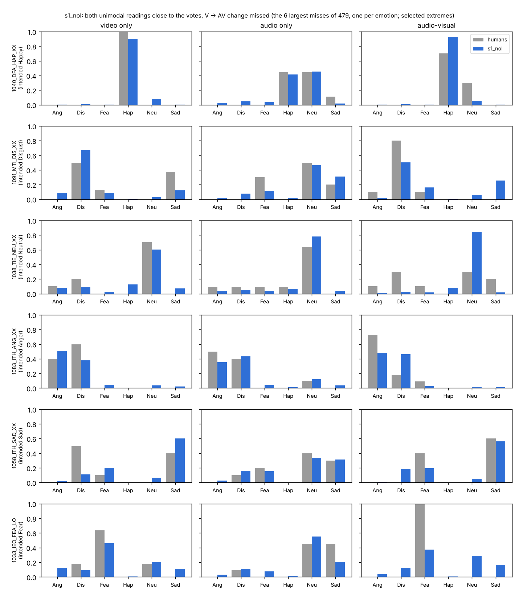

# Cross-condition diagnostic: summary and decision

Existing predictions only (Stage 1 outer runs, seed 0; every clip read by the fold model that never saw its actor;
7,438 clips, 91 actors). Full tables: `report.md`; script: `analysis/cross_condition_diagnostic.py`.

**Conclusion.** Under the current evaluation, the clearest remaining deficit is in video-only human-response
prediction. These diagnostics do not establish an additional cross-modal integration deficit after accounting for
unimodal prediction quality.

**Decision.** Close the fusion branch provisionally. Next: a controlled V-only adaptation baseline (`v_only`) to test
whether the V-only deficit comes from joint adaptation or from the representation.

## Diagnostic table (s1_noI)

"Human re-run" = a simulated independent re-run of the human study, compared with the observed votes. It is a
reference, not an upper bound and not an equivalence test: it depends on how the re-run is generated (see below), and
a model of the underlying distribution can exceed it. Brackets: 95% bootstrap over actors.

| Quantity | s1_noI | Emotion prior | Human re-run (main generator) | Reading |
| --- | --- | --- | --- | --- |
| **Each condition** — JSD to the votes (lower is better) | | | | |
| video only | 0.142 [0.138, 0.146] | — | 0.096 | clearly worse than the re-run |
| audio only | 0.087 [0.086, 0.089] | — | 0.100 | comparable to the re-run on this metric |
| audio-visual | 0.088 [0.085, 0.091] | — | 0.095 | comparable to the re-run on this metric |
| top label among the raters' top: video only | 0.651 | — | 0.784 | clearly worse |
| top label among the raters' top: audio only / AV | 0.774 / 0.802 | — | 0.730 / 0.807 | comparable |
| **Change V → AV, all clips** | | | | |
| redistribution (correlation over clip × label) | 0.326 [0.306, 0.345] | 0.255 | 0.550 | barely above the prior |
| entropy change (Spearman) | 0.202 [0.177, 0.228] | 0.143 | 0.391 | barely above the prior |
| **Change V → AV, clips whose two unimodal readings are good (n = 1,800)** | | | | |
| redistribution (correlation) | 0.522 [0.489, 0.551] | 0.339 | 0.529 | comparable, but see the selection caveat |
| entropy change (Spearman) | 0.416 [0.378, 0.455] | 0.289 | 0.376 | comparable, but see the selection caveat |
| **Change A → AV, all clips** | | | | |
| redistribution (correlation) | 0.684 [0.667, 0.698] | 0.653 | 0.693 | comparable; direction close to the prior |
| entropy change (Spearman) | 0.434 [0.406, 0.460] | 0.300 | 0.457 | comparable |
| **AV disambiguation** (AV raters agree more than both unimodal groups; humans 30% of clips) | | | | |
| recall | 0.479 [0.450, 0.505] | — | 0.476 | comparable in aggregate |
| precision | 0.370 [0.352, 0.390] | — | 0.466 | lower |
| false-positive rate | 0.349 [0.327, 0.372] | — | 0.233 | higher: flags too many clips |

## Qualifications

**The "both readings good" subset favours the model by construction.** With e^V = q^V − p^V and
e^AV = q^AV − p^AV, the redistribution error is exactly (q^AV − q^V) − (p^AV − p^V) = e^AV − e^V. Selecting clips with
small e^V therefore shrinks the quantity being measured. The re-run and the prior on the same subset do not remove this
model-dependent selection. The subset is consistent with the conclusion; it does not prove it on its own.

**The disambiguation aggregate hides opposite errors by emotion.** Per intended emotion, s1_noI flags too many clips for
Anger (64% of clips vs 31% for humans; false-positive rate 0.61), Disgust and Fear, and too few for Neutral (23% vs 30%)
and Sad (14% vs 25%; recall 0.21). The matching aggregate recall is the result of these errors cancelling, so the
diagnostic does not show that the failure patterns are absent; only that the aggregate metrics do not reveal a clear
additional integration deficit. The flagging pattern follows the unimodal readings: s1_noI's video-only entropy is
0.71–0.79 for every emotion except Happy (humans 0.39–0.50), so an AV reading easily looks "more certain" than it.
(`3b_disambiguation_by_emotion.csv`, `6_mean_entropy_by_emotion.csv`.)

**The re-run reference depends on its generator; the video-only gap does not.** s1_noI's JSD minus the re-run's
(`5_rerun_generator_sensitivity.csv`):

| Re-run generator | video only | audio only | audio-visual |
| --- | --- | --- | --- |
| Dirichlet(counts + 0.5) per clip (main) | +0.046 | −0.012 | −0.006 |
| empirical Bayes: Dirichlet(fitted prior + counts) | +0.069 | −0.001 | +0.023 |
| theta = observed proportions (no uncertainty in theta) | +0.112 | +0.052 | +0.061 |

The video-only gap is the largest under every generator. Whether audio-visual is "comparable" depends on the generator:
under empirical Bayes there is a small AV gap too (+0.023). The main generator adds 0.5 to each of six labels, three
pseudo-votes against about ten real ones, which makes the re-run noisier and the reference easier to meet.

**The video-only gap is not a global calibration offset.** A temperature per condition, fitted on the other folds by
cross-entropy, is about 1 for s1_noI in every condition and leaves the video-only JSD unchanged (0.142 → 0.142)
(`7_temperature_scaling.csv`). Together with experiment B (a learned 6 → 6 linear map of s1_noI's video-only logits
did not improve entropy ranking), a global or per-class probability-allocation error is unlikely to be the main cause.

**Joint training gave the video-only task little weight.** In s1_noI the V loss weight is 0.1 and the A weight 0.5
(chosen on the inner split for the AV criterion). The audio-only reading improved strongly over m3 (JSD 0.116 → 0.087);
the video-only reading hardly moved (0.148 → 0.142). This is why the next step is the controlled `v_only` baseline.

## Failure cases (illustrations, not evidence for a mechanism)

The six clips (one per emotion) where both unimodal readings of s1_noI are close to the votes but its V → AV change
points most against the human one: the 6 largest misses of 479 candidates, with about 10 raters per condition, so part
of each pattern is rater sampling noise. Two shapes recur: unimodal raters split while AV raters converge and the model
stays split (1083 Anger, 1033 Fear, 1091 Disgust); one channel clear, the other mixed, AV raters less sure and the model
confident (1040 Happy, 1038 Neutral).

## Caveats

One seed; Qwen2.5-Omni-7B only; CREMA-D only. The integration weight w is computed from the model's own unimodal
readings, so a weaker video-only reading raises the audio weight by itself.
